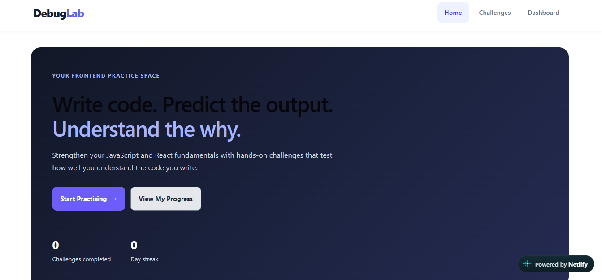
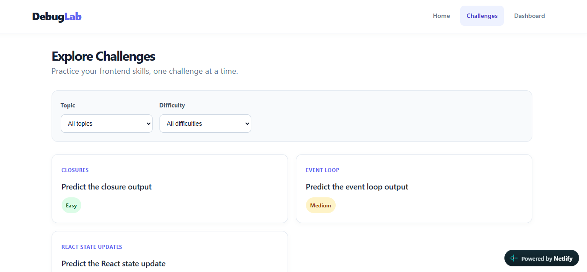
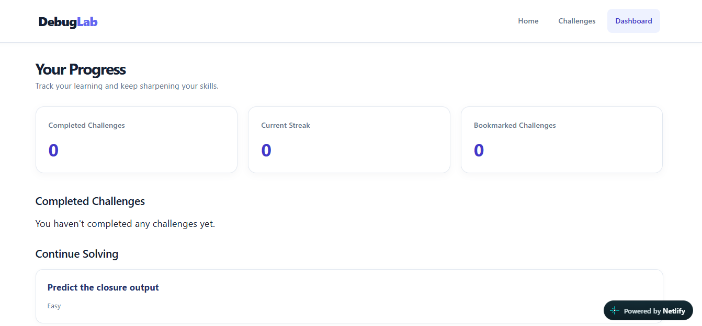

# DebugLab — Frontend Debugging Playground

**[🚀 Try DebugLab Live](https://debuglab-frontend.netlify.app)**

DebugLab is an interactive playground for practicing JavaScript and React debugging concepts. It presents coding challenges that help developers reason about code behavior, predict outputs, and understand common frontend pitfalls.

# DebugLab — Frontend Debugging Playground

DebugLab is an interactive playground for practicing JavaScript and React debugging concepts. It presents coding challenges that help developers reason about code behavior, predict outputs, and understand common frontend pitfalls.

## Screenshots

### Home


### Challenges


### Dashboard



## Features

- **Interactive challenges:** Solve JavaScript and React questions with multiple-choice answers.
- **Hints and explanations:** Get guidance and understand why an answer is correct.
- **Progress tracking:** Track completed challenges and your solving streak.
- **Bookmarks:** Save challenges to revisit later.
- **Dashboard:** View completed challenges, bookmarks, and current streak.
- **Persistent progress:** Keep your progress saved across page refreshes.
- **Topic and difficulty filters:** Browse challenges based on topic and difficulty.

## Tech Stack

- React
- JavaScript (ES6+)
- Redux Toolkit
- Redux Persist
- React Router
- CSS
- Vite

## Getting Started

### Prerequisites

- Node.js
- npm

### Installation

1. Clone the repository:

   ```bash
   git clone https://github.com/vanshikagarg2763/DebugLab.git
   ```

2. Navigate to the project directory:

   ```bash
   cd DebugLab
   ```

3. Install dependencies:

   ```bash
   npm install
   ```

4. Start the development server:

   ```bash
   npm run dev
   ```

5. Open the local URL shown in your terminal.

## Project Structure

```text
src/
├── components/     # Reusable UI components
├── data/           # Challenge data
├── features/       # Redux state management
├── pages/          # Application pages
├── store/          # Redux store and persistence
├── assets/         # Images and other assets
├── App.jsx
└── main.jsx
```

## Future Improvements

- Add more JavaScript and React challenges.
- Expand filtering and challenge discovery.
- Improve challenge statistics and progress insights.

## Author

Built as a personal project to practice frontend development and create a hands-on space for exploring JavaScript and React behavior.
